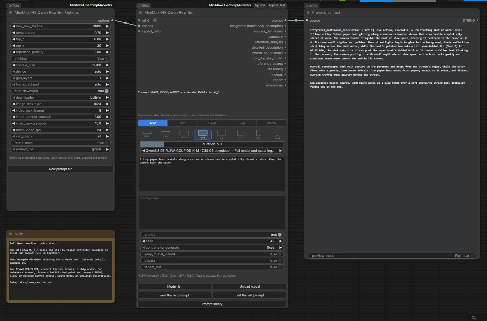

# Full Qwen rewriters

[Русская версия](qwen_rewriter_RU.md) · [中文版](qwen_rewriter_ZH.md)

**MiniMax-H3 Qwen Rewriter** loads LightX2V's full Qwen checkpoints. It reads the
reference images itself and writes the H3 sections in one generation. Connect
**MiniMax-H3 Qwen Rewriter Options** for sampling, thinking, memory and media settings.

| Checkpoint | Tasks | Original weights | GGUF Q5_K_M / Q4_K_M |
|---|---|---|---|
| Qwen3.5 9B FL2VA | T2VA, I2VA, L2VA, FL2VA | [LightX2V SFT](https://huggingface.co/lightx2v/MiniMax-H3-Prompt-Rewriter-Qwen3.5-9B-FL2VA) | [pytraveler GGUF](https://huggingface.co/pytraveler/MiniMax-H3-Prompt-Rewriter-Qwen3.5-9B-FL2VA-GGUF) |
| Qwen3.5 9B Ref2VA | Ref2VA | [LightX2V SFT](https://huggingface.co/lightx2v/MiniMax-H3-Prompt-Rewriter-Qwen3.5-9B-Ref2VA) | [pytraveler GGUF](https://huggingface.co/pytraveler/MiniMax-H3-Prompt-Rewriter-Qwen3.5-9B-Ref2VA-GGUF) |
| Qwen3.8 27B FL2VA | T2VA, I2VA, L2VA, FL2VA | [LightX2V SFT](https://huggingface.co/lightx2v/MiniMax-H3-Prompt-Rewriter-Qwen3.8-27B-FL2VA) | [pytraveler GGUF](https://huggingface.co/pytraveler/MiniMax-H3-Prompt-Rewriter-Qwen3.8-27B-FL2VA-GGUF) |
| Qwen3.8 27B Ref2VA | Ref2VA | [LightX2V SFT](https://huggingface.co/lightx2v/MiniMax-H3-Prompt-Rewriter-Qwen3.8-27B-Ref2VA) | [pytraveler GGUF](https://huggingface.co/pytraveler/MiniMax-H3-Prompt-Rewriter-Qwen3.8-27B-Ref2VA-GGUF) |

The model list has its own `qwen_rewriters` section. Original SFT directories
and GGUF model/projector pairs belong here. The older LoRA nodes keep their own
lists and settings. A full checkpoint does not need a base-model download plus
a separate adapter.

## Quick start

Open [12 - Write with the full Qwen model](../example_workflows/12%20-%20Write%20with%20the%20full%20Qwen%20model.json)
from the template browser. It connects Options, a 9B FL2VA Q5_K_M writer and a
text preview. The model and projector total 7.39 GB; first use can also fetch
the runtime and task guide. No MiniMax video weights are needed to write a prompt.

The example disables thinking and uses a 3000-token output budget for a short
T2VA run. Change the task and connect the required frames, or choose a Ref2VA
checkpoint for mixed references. The node's normal defaults still enable thinking.

## Connect references

Connect an IMAGE, VIDEO, AUDIO or decoded RefMod to `ref_0`. Another free input
appears when it is connected. Each input has a checkbox; disabling it keeps the
wire and excludes that reference from the request and the `references` output.
Disabled references are lazy inputs, so the writer does not request their
upstream execution.

The chips are the first controls in the node. Drag them to set the order, click
below the label to enable or disable one, and use **+ instr** for instructions
and descriptions. **Save instructions** applies the edit; **Cancel** discards
it. **Clear** empties the fields and waits for Save.

For the frame tasks, enable exactly the required Picture inputs:

| Task | Pictures, in chip order |
|---|---|
| T2VA | None; connected references are ignored |
| I2VA | Exact first frame |
| L2VA | Exact last frame |
| FL2VA | Exact first frame, then exact last frame |
| Ref2VA | Ordered Pictures, Subjects, Videos and Audio descriptions |

A batch assigned the Picture role contains several images, so it cannot stand
for one exact first/last frame. Select one frame upstream. In Ref2VA, an IMAGE
batch may instead have the Video role; `batch_video_fps` supplies its clock.

Videos reach the writer as sampled frames with source timestamps. The frame
cap, sampling interval, reference-window limit and target duration bound the
copies. RefMods need decoded pictures from their loader's H3 video VAE input.
Their original conditioning is preserved in `references`, ready for Reference
Encode. The report lists the actual frames and timestamps shown to the writer.

**These Qwen checkpoints have no audio encoder.** For AUDIO, fill in a sound
description through **+ instr**. If a Video's sound is enabled, fill in its clip
sound description too. Saved RefMod voice descriptions can supply that text.
An undescribed sound stops before inference. Waveforms are not sent to the
model; the original audio still passes through `references`.

Enabled AUDIO and video-sound chips show a red **!**. Hover over it for the
sound-description instructions, or click it to open the reference editor.
The badge remains after a description is supplied: Qwen reads that text instead
of hearing the recording. Turning off a video's sound removes the badge and
keeps the video enabled.

If a required description is empty, a **Stopped** notification identifies each
reference and its input slot, names the field to fill, and explains how to omit
the sound. This input notice also appears with `self_check=none`.

## Choose weights and settings

SFT uses the original processor and Transformers with `qwen3_5` support; 9B has
been run with Transformers 5.8.0. Keep the complete checkpoint directory,
including tokenizer, processor and all indexed weight shards. The defaults
load BF16 weights. The SFT-only `quantization` control also offers `float16`,
`nf4` and `int8`; the latter two require bitsandbytes.

GGUF uses a local `llama-server` owned by this node. Both the model and its
vision `mmproj` must come from the same checkpoint conversion. The runtime
search and backend selector are shared with the pack's other local nodes.
`gpu_layers` controls offloading; precision comes from the selected GGUF file.
No separately running API provider is needed for this path.

`keep_model_loaded` keeps the SFT model or the owned GGUF server between runs.
**Unload model** and ComfyUI's **Unload Models** release it. Cancellation closes
the owned server or waits for the SFT generation worker to finish interrupting.

The upstream sampling defaults are `temperature=0.7`, `top_p=0.8`, `top_k=20`
and a 16384-token output budget. Thinking is enabled by default. The output
budget includes reasoning: if it ends inside a thought, the node reports an
empty final answer instead of returning analysis as the video prompt. Increase
the budget or disable thinking for shorter runs. `context_size` must hold both
the request and output budget; the default is 32768.

The aspect-ratio picker and duration slider use the pack's shared controls.
A connected `aspect_ratio` overrides the picker. Duration accepts FLOAT and
INT connections; its context menu changes the slider ceiling.

An empty `system_prompt` uses LightX2V's task prefix and the official MiniMax
writing guide. Guides are downloaded into the ComfyUI user directory on first
use, with the same editable copies as the existing writers. A custom system
prompt replaces that entire message. Individual reference instructions remain
next to their images in either case.

## Outputs and reuse

`prompt` contains the complete result. The seven section outputs cover both
checkpoint families; sections not used by the current task are empty.
`reference_assets` records the labels, roles and instructions. `reasoning` is
separate, `findings` contains H3 checks, and `report` records the model, settings,
generation count and prepared media. Native completion counts are explicitly
labelled as re-encoded counts; the GGUF path uses server usage when supplied.

`bypass` returns the original prompt and enabled references without model work.
`repeat_last` reuses the last result or the prompt selected in the library.
The usual save, edit and browse buttons work here. Options selects the prompt
library file and can create another one.

`repair_once` is off by default. When enabled, repairable findings can trigger
one extra generation. The second result replaces the first only if the checks
improve; the report records both attempts.
