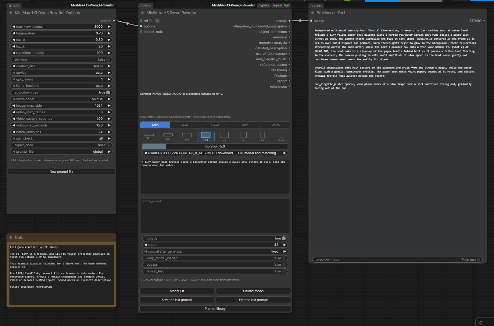

# Qwen Rewriter: полные модели

[English version](qwen_rewriter.md) · [中文版](qwen_rewriter_ZH.md)

**MiniMax-H3 Qwen Rewriter** загружает полные Qwen-чекпойнты LightX2V.
Модель сама читает референсные изображения и за одну генерацию пишет разделы
H3-промта. Подключите **MiniMax-H3 Qwen Rewriter Options**, чтобы настроить
сэмплирование, рассуждения (thinking), память и подготовку медиа.

| Чекпойнт | Задачи | Исходные веса | GGUF Q5_K_M / Q4_K_M |
|---|---|---|---|
| Qwen3.5 9B FL2VA | T2VA, I2VA, L2VA, FL2VA | [LightX2V SFT](https://huggingface.co/lightx2v/MiniMax-H3-Prompt-Rewriter-Qwen3.5-9B-FL2VA) | [pytraveler GGUF](https://huggingface.co/pytraveler/MiniMax-H3-Prompt-Rewriter-Qwen3.5-9B-FL2VA-GGUF) |
| Qwen3.5 9B Ref2VA | Ref2VA | [LightX2V SFT](https://huggingface.co/lightx2v/MiniMax-H3-Prompt-Rewriter-Qwen3.5-9B-Ref2VA) | [pytraveler GGUF](https://huggingface.co/pytraveler/MiniMax-H3-Prompt-Rewriter-Qwen3.5-9B-Ref2VA-GGUF) |
| Qwen3.8 27B FL2VA | T2VA, I2VA, L2VA, FL2VA | [LightX2V SFT](https://huggingface.co/lightx2v/MiniMax-H3-Prompt-Rewriter-Qwen3.8-27B-FL2VA) | [pytraveler GGUF](https://huggingface.co/pytraveler/MiniMax-H3-Prompt-Rewriter-Qwen3.8-27B-FL2VA-GGUF) |
| Qwen3.8 27B Ref2VA | Ref2VA | [LightX2V SFT](https://huggingface.co/lightx2v/MiniMax-H3-Prompt-Rewriter-Qwen3.8-27B-Ref2VA) | [pytraveler GGUF](https://huggingface.co/pytraveler/MiniMax-H3-Prompt-Rewriter-Qwen3.8-27B-Ref2VA-GGUF) |

В списке моделей для них выделен раздел `qwen_rewriters`. В него добавляются
каталоги исходных SFT и пары GGUF-модель/проектор. У прежних LoRA-нод свои
списки и настройки. Полный чекпойнт не требует отдельной загрузки базовой
модели и адаптера.

## Быстрый старт

Откройте [12 - Write with the full Qwen model](../example_workflows/12%20-%20Write%20with%20the%20full%20Qwen%20model.json)
в браузере шаблонов. В нём соединены Options, писатель с 9B FL2VA Q5_K_M и
просмотрщик текста. Модель с проектором занимают 7.39 ГБ; при первом запуске
могут также скачаться рантайм и гайд для выбранной задачи. Для написания
промта веса видеогенератора MiniMax не нужны.

В примере thinking выключен, а лимит вывода равен 3000 токенам для короткого
прогона T2VA. Выберите другую задачу и подключите нужные кадры либо возьмите
Ref2VA-чекпойнт для набора разных референсов. В обычных настройках ноды
thinking по умолчанию включён.

## Подключение референсов

Подключите IMAGE, VIDEO, AUDIO или декодированный RefMod к `ref_0`. Рядом
появится следующий свободный вход. У каждого входа есть checkbox: отключение
сохраняет провод, но исключает референс из запроса и выхода `references`.
Отключённые референсы используют ленивые входы: писатель не запрашивает
выполнение подключённых к ним нод.

Чипы расположены в самом верху среди элементов управления. Перетаскивайте их,
чтобы задать порядок, нажимайте под меткой для включения/отключения, а
**+ instr** используйте для инструкций и описаний. **Save instructions**
применяет изменения, **Cancel** отменяет их. **Clear** очищает поля; чтобы
применить очистку, затем нажмите Save.

Для кадровых задач включите ровно столько входов Picture, сколько требуется:

| Задача | Изображения в порядке чипов |
|---|---|
| T2VA | Не нужны; подключённые референсы игнорируются |
| I2VA | Точный первый кадр |
| L2VA | Точный последний кадр |
| FL2VA | Точный первый кадр, затем точный последний |
| Ref2VA | Упорядоченные Picture, Subject, Video и описания Audio |

Батч с ролью Picture содержит несколько изображений и не может считаться
одним точным первым/последним кадром. Выберите один кадр в предыдущей ноде.
В Ref2VA батчу IMAGE можно назначить роль Video; частоту его кадров задаёт
`batch_video_fps`.

Видео поступает писателю как выборка кадров с временными отметками исходника.
Объём выборки ограничен числом кадров, интервалом, допустимым окном референса
и длительностью целевого видео. RefMod нужны декодированные изображения:
подключите H3 video VAE к его загрузчику. Исходное кондиционирование
сохраняется в `references` для передачи в Reference Encode. В отчёте
перечислены фактические кадры и временные отметки, показанные писателю.

**У этих Qwen-чекпойнтов нет аудиоэнкодера.** Для AUDIO заполните описание
звука через **+ instr**. Если у Video включён звук, заполните и описание
звуковой дорожки клипа. Для RefMod может использоваться сохранённое описание
голоса. Звук без описания останавливает выполнение до инференса. Волновая
форма не передаётся модели; исходное аудио остаётся на выходе `references`.

У включённых AUDIO и видеочипов со звуком появляется красный **!**.
Наведите на него курсор для подсказки или нажмите, чтобы открыть редактор
референса. После заполнения описания значок остаётся: Qwen читает этот текст,
а не слушает запись. Если отключить звук видео, значок исчезнет, а само видео
останется включённым.

Если обязательное описание пусто, уведомление **Stopped** укажет каждый
референс, его вход, нужное поле и способ исключить звук из запроса. Такое
уведомление появляется и при `self_check=none`.

## Выбор весов и настроек

SFT использует исходный процессор и Transformers с поддержкой `qwen3_5`;
9B проверена с Transformers 5.8.0. Нужен полный каталог чекпойнта, включая
токенизатор, процессор и все шарды весов, перечисленные в индексе. По
умолчанию веса загружаются в BF16. Параметр `quantization` для SFT также
предлагает `float16`, `nf4` и `int8`; последние два требуют bitsandbytes.

Для GGUF нода запускает собственный локальный `llama-server`. Модель и
визуальный `mmproj` должны происходить из одной конверсии чекпойнта. Поиск
рантайма и выбор бэкенда общие с остальными локальными нодами пака.
`gpu_layers` задаёт число слоёв на GPU, а точность определяется выбранным
GGUF-файлом. Отдельно запущенный API-провайдер для этого пути не нужен.

`keep_model_loaded` сохраняет SFT-модель или собственный GGUF-сервер между
прогонами. **Unload model** и штатная **Unload Models** в ComfyUI выгружают
их. Отмена завершает собственный сервер либо дожидается остановки рабочего
потока генерации SFT.

Исходные настройки сэмплирования: `temperature=0.7`, `top_p=0.8`, `top_k=20`
и лимит вывода 16384 токена. Thinking по умолчанию включён. Его рассуждения
расходуют тот же лимит: если он закончится внутри рассуждения, нода сообщит
об отсутствии итогового промта. Анализ не выдаётся за промт для видео.
Увеличьте лимит либо отключите thinking для коротких прогонов.
`context_size` должен вмещать запрос и лимит вывода; по умолчанию это 32768.

Выбор соотношения сторон и ползунок длительности используют общие элементы
управления пака. Подключённый `aspect_ratio` имеет приоритет над выбором в
ноде. Длительность принимает соединения FLOAT и INT; её контекстное меню
позволяет изменить верхний предел ползунка.

Пустой `system_prompt` использует префикс задачи LightX2V и официальный гайд
MiniMax по написанию промтов. При первом использовании гайды скачиваются в
пользовательский каталог ComfyUI; это те же редактируемые копии, которые
используют остальные писатели. Собственный system prompt заменяет всё это
сообщение. Индивидуальные инструкции референсов в обоих случаях остаются
рядом с их изображениями.

## Выходы и повторное использование

`prompt` содержит полный результат. Семь выходов разделов охватывают оба
семейства чекпойнтов; неиспользуемые в текущей задаче разделы пусты.
`reference_assets` перечисляет метки, роли и инструкции. `reasoning` выдаёт
рассуждения отдельно, `findings` содержит результаты H3-проверок, а `report`
записывает модель, настройки, число генераций и подготовленные медиа. На пути
SFT число токенов завершения явно помечено как полученное повторной
токенизацией; GGUF использует статистику сервера, если тот её передал.

`bypass` возвращает исходный промт и включённые референсы без работы модели.
`repeat_last` повторно выдаёт последний результат или выбранный в библиотеке
промт. Обычные кнопки сохранения, редактирования и просмотра библиотеки
работают и здесь. В Options выбирается файл библиотеки; там же можно
создать новый.

`repair_once` по умолчанию выключен. Если его включить, исправимые замечания
могут вызвать одну дополнительную генерацию. Второй результат заменяет
первый только при улучшении проверок; отчёт учитывает обе попытки.
