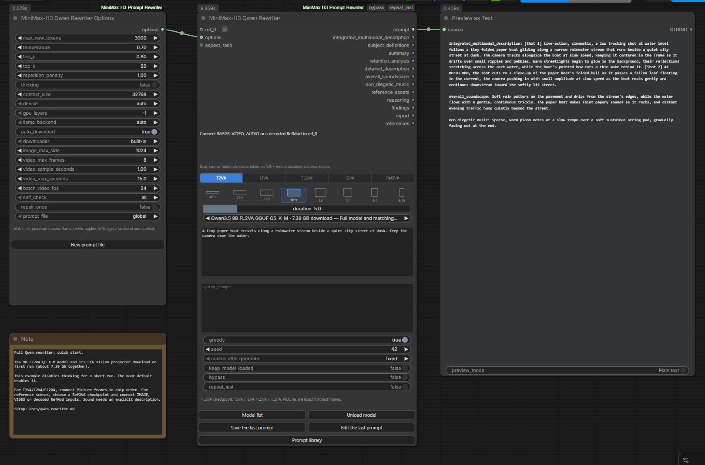

# 完整 Qwen 重写模型

[English version](qwen_rewriter.md) · [Русская версия](qwen_rewriter_RU.md)

**MiniMax-H3 Qwen Rewriter** 加载 LightX2V 的完整 Qwen 检查点。
模型直接读取参考图像，在一次生成中写出 H3 提示词的各个部分。
连接 **MiniMax-H3 Qwen Rewriter Options**，即可设置采样、思考模式、
内存和参考素材处理参数。

| 检查点 | 任务 | 原始权重 | GGUF Q5_K_M / Q4_K_M |
|---|---|---|---|
| Qwen3.5 9B FL2VA | T2VA, I2VA, L2VA, FL2VA | [LightX2V SFT](https://huggingface.co/lightx2v/MiniMax-H3-Prompt-Rewriter-Qwen3.5-9B-FL2VA) | [pytraveler GGUF](https://huggingface.co/pytraveler/MiniMax-H3-Prompt-Rewriter-Qwen3.5-9B-FL2VA-GGUF) |
| Qwen3.5 9B Ref2VA | Ref2VA | [LightX2V SFT](https://huggingface.co/lightx2v/MiniMax-H3-Prompt-Rewriter-Qwen3.5-9B-Ref2VA) | [pytraveler GGUF](https://huggingface.co/pytraveler/MiniMax-H3-Prompt-Rewriter-Qwen3.5-9B-Ref2VA-GGUF) |
| Qwen3.8 27B FL2VA | T2VA, I2VA, L2VA, FL2VA | [LightX2V SFT](https://huggingface.co/lightx2v/MiniMax-H3-Prompt-Rewriter-Qwen3.8-27B-FL2VA) | [pytraveler GGUF](https://huggingface.co/pytraveler/MiniMax-H3-Prompt-Rewriter-Qwen3.8-27B-FL2VA-GGUF) |
| Qwen3.8 27B Ref2VA | Ref2VA | [LightX2V SFT](https://huggingface.co/lightx2v/MiniMax-H3-Prompt-Rewriter-Qwen3.8-27B-Ref2VA) | [pytraveler GGUF](https://huggingface.co/pytraveler/MiniMax-H3-Prompt-Rewriter-Qwen3.8-27B-Ref2VA-GGUF) |

模型列表为这些模型单独提供了 `qwen_rewriters` 分区。原始 SFT 目录和
GGUF 模型/投影器配对应放在这里。原有 LoRA 节点使用各自的列表和设置。
完整检查点不需要另行下载基础模型和适配器。

## 快速开始

在模板浏览器中打开 [12 - Write with the full Qwen model](../example_workflows/12%20-%20Write%20with%20the%20full%20Qwen%20model.json)。
模板连接了 Options、使用 9B FL2VA Q5_K_M 的写作节点和文本预览。
模型与投影器合计 7.39 GB；首次运行还可能下载运行时和所选任务的指南。
仅生成提示词时，无需 MiniMax 视频生成模型的权重。

为了快速完成一次简短的 T2VA 生成，示例关闭了 thinking，并把输出上限设为
3000 个 token。可以切换任务并连接所需帧，或选择 Ref2VA 检查点来处理多种
参考素材。节点本身的默认设置仍然开启 thinking。

## 连接参考素材

将 IMAGE、VIDEO、AUDIO 或已解码的 RefMod 连接到 `ref_0`，随后会出现下一个
空闲输入。每个输入都有复选框；取消勾选会保留连线，但把该素材排除在请求和
`references` 输出之外。被禁用的参考素材使用惰性输入，写作节点不会请求执行
连接在这些输入上的上游节点。

参考芯片位于节点控件的最上方。拖动芯片可以调整顺序，点击标签下方可启用或
禁用素材，**+ instr** 用于填写指令和描述。**Save instructions** 应用修改，
**Cancel** 放弃修改。**Clear** 清空字段，之后仍需点击 Save 才会应用。

对于指定首尾帧的任务，只启用所需数量的 Picture 输入：

| 任务 | 按芯片顺序提供的图像 |
|---|---|
| T2VA | 不需要；忽略已连接的参考素材 |
| I2VA | 确切的首帧 |
| L2VA | 确切的尾帧 |
| FL2VA | 确切的首帧，然后是确切的尾帧 |
| Ref2VA | 按顺序提供 Picture、Subject、Video 和 Audio 描述 |

Picture 角色的图像批次包含多张图，不能当作一张确切的首帧或尾帧。
请先在上游选择一帧。在 Ref2VA 中，也可以把 IMAGE 批次设为 Video 角色；
`batch_video_fps` 用于指定它的帧率。

视频以采样帧的形式送入模型，每帧带有源视频的时间戳。帧数上限、采样间隔、
参考片段的时间窗口上限和目标视频时长共同限制采样量。RefMod 需要解码后的
图像，因此应在其加载节点上连接 H3 video VAE。原始条件数据保留在
`references` 输出中，可继续送入 Reference Encode。报告会列出模型实际看到
的帧和时间戳。

**这些 Qwen 检查点没有音频编码器。** 对于 AUDIO，请通过 **+ instr**
填写声音描述。若启用了 Video 的声音，还需要填写该片段的音轨描述。
RefMod 中保存的语音描述也可提供这段文字。缺少描述时，节点会在推理前停止。
音频波形不会发送给模型；原始音频仍通过 `references` 输出传递。

启用的 AUDIO 芯片和带声音的视频芯片会显示红色 **!**。悬停可查看声音描述的
填写说明，点击则打开参考素材编辑器。填写描述后，标记仍然保留：Qwen 读取
的是这段文字，并不聆听录音。关闭视频的声音后，标记会消失，视频本身仍保持启用。

如果必填描述为空，**Stopped** 通知会逐一指出相关素材、输入插槽、应填写的
字段，以及如何从请求中排除声音。即使设置了 `self_check=none`，这类输入
通知也会显示。

## 选择权重与设置

SFT 路径使用原始处理器和支持 `qwen3_5` 的 Transformers；9B 已在
Transformers 5.8.0 上运行验证。请保留完整检查点目录，包括 tokenizer、
processor 和索引中列出的所有权重分片。默认加载 BF16 权重。
仅用于 SFT 的 `quantization` 还可选择 `float16`、`nf4` 和 `int8`；
后两项需要 bitsandbytes。

GGUF 路径由节点启动自己的本地 `llama-server`。模型和视觉 `mmproj` 必须
来自同一检查点的同一次转换。运行时查找方式和后端选择与节点包中的其他本地
节点共用。`gpu_layers` 控制加载到 GPU 的层数，精度由所选 GGUF 文件决定。
此路径不需要另行运行 API 服务。

`keep_model_loaded` 会在两次运行之间保留 SFT 模型或节点自己的 GGUF 服务。
**Unload model** 和 ComfyUI 的 **Unload Models** 都可以将其卸载。
取消任务会关闭节点启动的服务，或等待 SFT 生成线程完成中断。

上游采样默认值为 `temperature=0.7`、`top_p=0.8`、`top_k=20`，输出上限为
16384 个 token，默认开启 thinking。思考过程也占用输出额度：如果额度在
思考结束前耗尽，节点会报告没有最终提示词，不会把分析过程当作视频提示词。
可以提高上限，或在短任务中关闭 thinking。`context_size` 必须同时容纳
输入和输出额度，默认值为 32768。

宽高比选择器和时长滑块使用节点包的共用控件。连接到 `aspect_ratio` 的值
优先于节点内的选择。时长接受 FLOAT 和 INT 连线，可通过其右键菜单调整
滑块上限。

`system_prompt` 为空时，节点使用 LightX2V 的任务前缀和 MiniMax 官方写作
指南。首次使用时，指南下载到 ComfyUI 用户目录，与其他写作节点使用同一份
可编辑副本。自定义 system prompt 会替换整条系统消息。无论采用哪种方式，
各参考素材的单独指令仍放在对应图像旁边。

## 输出与复用

`prompt` 包含完整结果。七个分段输出覆盖两个检查点系列；当前任务不用的
部分为空。`reference_assets` 记录标签、角色和指令。`reasoning` 单独输出
思考过程，`findings` 包含 H3 检查结果，`report` 则记录模型、设置、生成次数
和准备好的参考素材。SFT 路径中的输出 token 数明确标注为重新分词后的计数；
GGUF 路径在服务提供用量统计时采用该统计。

`bypass` 原样返回输入提示词和启用的参考素材，不运行模型。`repeat_last`
复用上一次结果或提示词库中选中的提示词。常用的保存、编辑和浏览按钮在这里
同样可用。Options 可以选择提示词库文件，也可以新建一个文件。

`repair_once` 默认关闭。开启后，可修复的检查问题可能触发一次额外生成。
只有检查结果改善时，第二次结果才会替换第一次；报告会记录两次尝试。
